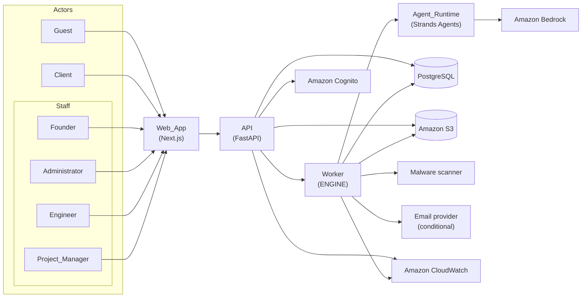
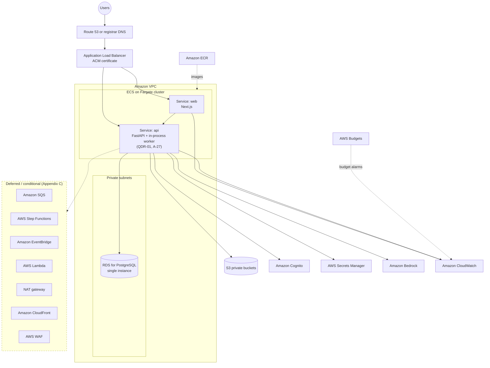
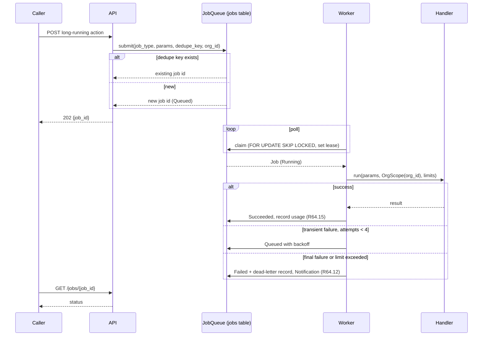
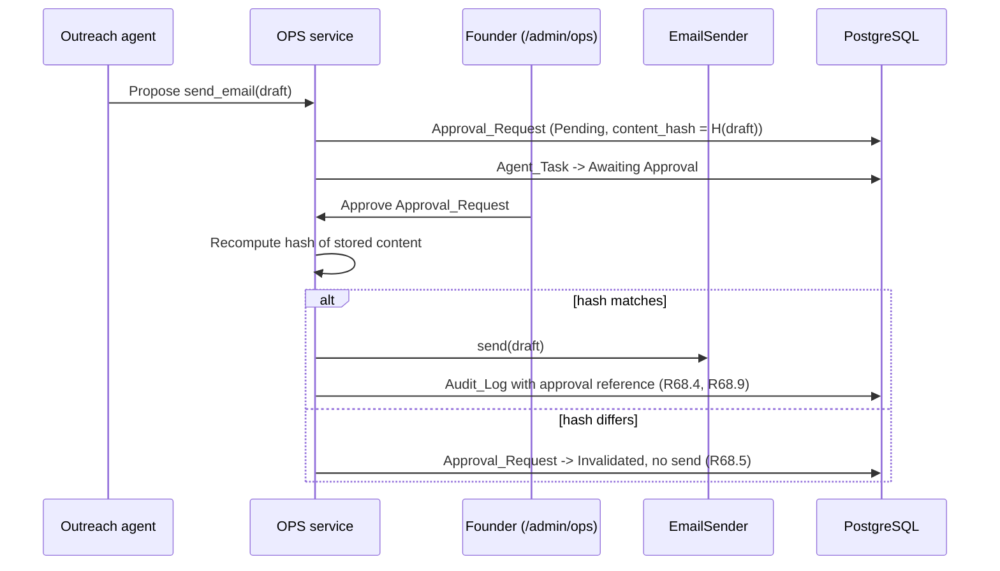
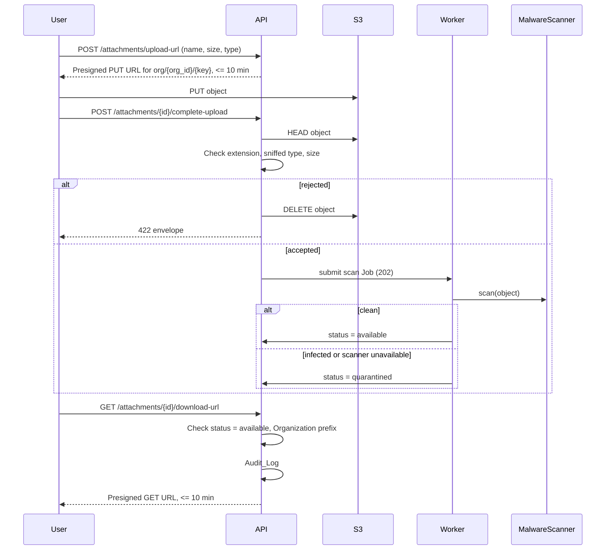
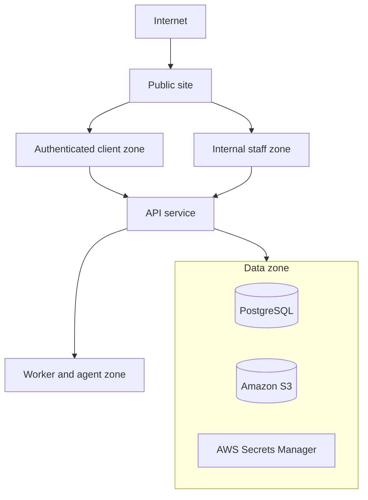
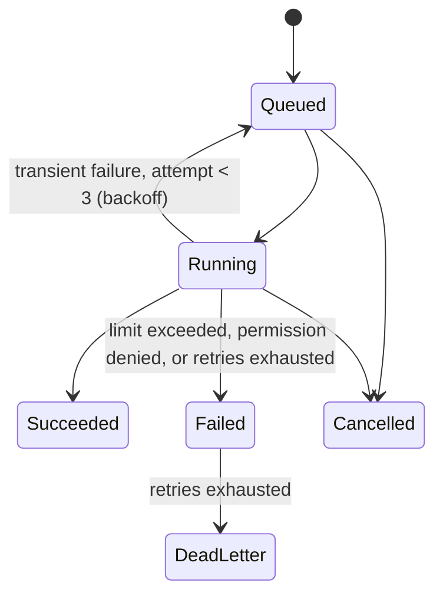

# Design Document

**Version:** 1.0
**Status:** Draft for Founder review
**Scope:** Requirements R1 to R79 of `requirements.md` V2.0. Nothing is implemented. No AWS resources are authorized; every billable deployment needs the Founder's written authorization (R3.6).

## Overview

### Purpose

NEUROPATH is a services-first engineering company. The platform supports the company's work: a public website that takes project inquiries, a Founder Control Center for CRM, discovery, proposals and delivery, a client workspace for tracking projects, optional Labs, an internal execution layer (ENGINE), and internal operational support (OPS). Clients never need to use a Lab to start or run a project (R55.8).

### Design Goals

- **Small founding team.** One API service with an in-process worker, one web service, one database, and one deployment path. Services are added only when Appendix C records a need (A-27, R76.5).
- **Human decisions for every commercial or external action.** Qualify, reject, approve, send, accept and publish decisions come only from human principals. Agents and the Agent_Runtime produce drafts and advisory output only (R21.8, R43.4, R65, R68.7).
- **Tenant isolation.** Every client-owned record is scoped to an Organization, and every read and write is checked against the Appendix A.3 permission matrix.
- **Deterministic data processing.** Data Engine and Playground transformations give the same output for the same input and parameters. Model output never replaces a deterministic computation.
- **Cost control.** Budget alarms come before any other resource (R7.4). Usage is recorded per job and per model call (R42, R64.15). Each AWS service in use has an Appendix C justification (R76.5).
- **Local development without AWS.** Every external dependency has a local adapter behind the same interface (R3), so the full system runs and is tested on a laptop.

### Non-Goals

- Payment processing and billing. Commercial_Records track payment state only (R79).
- E-signature (A-13).
- Customer-facing OPS. OPS is internal (A-28).
- Executing model-generated code (Scope Register Out-of-scope; R58.7, R64.4).
- Multi-region deployment.

### What Each Phase Adds

| Phase | What the running system gains |
|---|---|
| 0 Foundation | A buildable, tested monorepo skeleton with CI, a database baseline, architecture decision records, local Docker Compose, and cost controls. No billable resources unless authorized. |
| 1 Public Company Website | The public site (Services, Solutions, Projects, How We Work, About, Insights, Contact) with SEO and a project inquiry form that stores genuine inquiries. |
| 2 Client Acquisition and Founder CRM | Authentication, Organizations and users, inquiry review and lead management, the Founder dashboard, internal assessments, notifications, attachments with malware scanning, and a basic client workspace. |
| 3 Solution Discovery and Proposal | The AI Solution Architect, requirement analysis, clarifications, architecture diagrams, technical assessments, proposal drafting, versioned review and approval, and client acceptance. Bedrock calls start here. |
| 4 Project Delivery and Engineering Labs | Project activation, milestones, tasks, team assignment, client communication, deliverables, testing, deployment and handover records, support requests, Commercial_Records (R79), and Labs as independent modules, with the Data Engineering Playground gated by the Founder (A-04). |
| 5 NEUROPATH OPS and ENGINE | The full ENGINE job framework (R64), Agent_Runtime orchestration, the MVP OPS workflow (R67), approvals, and cost monitoring. Other OPS workflows stay Optional (A-28). |
| 6 Production Readiness | Security review, load tests and p95 measurements, backups and restore drills, monitoring and alarms, recovery targets, cost review, and deployment and rollback documentation (R74 to R76). |

## Architecture

### System Context



The Web_App holds no secrets and talks only to the API (R2). The API owns authorization, validation and persistence. The Worker runs ENGINE Jobs: scans, AI analysis, Playground runs, scheduled jobs, and OPS Agent_Tasks. All model calls go through the Agent_Runtime, which the Worker invokes; the Web_App never calls Bedrock.

### Deployment View

This view shows the deployed AWS setup per Appendix C. The Web_App runs as a second Fargate service behind the same load balancer. This is the design decision for the Next.js hosting question (Appendix C, option a); it remains a Founder decision. The worker runs inside the API task until job volume or isolation needs a separate service (QDR-01, A-27, Appendix C.2).



AWS KMS with AWS managed keys encrypts RDS, S3 and Secrets Manager at rest (Appendix C.1). The malware scanning product and the email provider are not chosen yet (A-16), so they are omitted from this diagram. They are reached through the MalwareScanner and EmailSender interfaces described under Integration Interfaces. Each item in the dashed group is adopted only when its Appendix C trigger occurs.

**Local development.** Docker Compose runs the full system without AWS (R3). The stack has the `web` container, an `api` container with the in-process worker, and a PostgreSQL container. A local filesystem adapter stands in for S3 behind the storage interface. A local auth adapter issues development tokens and is enabled only in the local environment. A stub scanner reports "scanner unavailable", so files stay quarantined; it never reports a clean result (R3.4). An outbox adapter writes email to a file or log. A stubbed model client returns recorded responses, so the default CI run makes no Bedrock call (R77.10).

### Monorepo Layout

```text
neuropath/
├── apps/
│   ├── web/                 # Next.js Web_App: public site, Client_Workspace, Founder_Control_Center
│   └── api/                 # FastAPI API and ENGINE worker
│       ├── api/             # HTTP routers, request/response wiring, auth dependencies
│       ├── core/            # Config, security, permissions (Appendix A.3), errors, logging
│       ├── models/          # ORM models and status enums (Appendix A)
│       ├── schemas/         # Pydantic request/response and event schemas
│       ├── services/        # Business logic and status transitions
│       ├── repositories/    # Data access, Organization scoping
│       ├── workers/         # ENGINE job interface, in-process queue, job handlers
│       ├── labs/            # (design decision) One independent module per Lab, registered at startup
│       └── tests/           # Unit, property, and integration tests
├── data_engine/             # (design decision: root level) Created when first needed by R56-R63
│                            #   (Phase 4B, only after a go decision, A-04): profiling, validation,
│                            #   transformations, feature_engineering, reporting
├── agents/                  # (design decision: root level) Created when first needed by R65
│                            #   (Phase 5): one subdirectory per OPS agent
├── packages/                # Shared code: design tokens, UI components, generated API types
├── infrastructure/          # IaC (CDK or Terraform, per A-10) and Docker Compose
├── docs/                    # ARCHITECTURE.md, DEPLOYMENT.md, decision records, phase reports
└── scripts/                 # Developer and CI scripts: seed, migrate, lint, checks
```

| Folder | Responsibility |
|---|---|
| `apps/web` | All user-facing pages and client-side state; holds no secrets. |
| `apps/api` | Authorization, validation, persistence, and the ENGINE worker. |
| `data_engine` | Deterministic data processing for the Playground. Root-level placement is a design decision; R1.3 requires only creation in the phase that first needs it, which is R56-R63 (Phase 4B, only after a go decision, A-04). |
| `agents` | OPS agent definitions that run inside the Agent_Runtime. Root-level placement is a design decision; first needed by R65 (Phase 5, R1.3). |
| `apps/api/labs` | Lab modules (R1.4, R55.10). The location is a design decision; R1.4 requires only isolation. |
| `packages` | Code shared between apps. |
| `infrastructure` | Infrastructure as code and local environment definitions. |
| `docs` | Architecture, deployment, and decision documentation, including any layout deviations (R1.5). |
| `scripts` | Repeatable developer and CI tasks. |

Each Lab is an independent module (R1.4, R55.10). Web-side Lab pages live under a matching Lab route group in `apps/web`. **Dependency rule:** core project, inquiry, proposal, and authentication modules never import a Lab module. Labs may import core modules. A CI import check enforces the rule and fails the build on a violation (R55.9).

### Backend Layering

The API follows one dependency direction: `api` (routers) → `services` → `repositories` → `models`. Routers never touch the ORM session directly, and repositories hold no business rules.

- **routers (`api/`)**: HTTP wiring, auth dependencies, request and response schemas.
- **services**: business logic, status transitions through the Status Transition Engine, audit writes, Job submission.
- **repositories**: data access with mandatory Organization scoping.
- **models**: SQLAlchemy models and status enums (Appendix A).
- **core**: configuration and settings (environment variables locally, AWS Secrets Manager in deployed environments, R3.2), security, the code-defined permission matrix (Appendix A.3), the error types, and structured logging that carries the request id (R19.4).

**Tenant-scoped repositories.** Every tenant repository method takes an `OrgScope` argument and adds the Organization filter to its query. An `OrgScope` is either the set of Organization ids the principal may access or an explicit internal-staff scope. There is no unscoped method on a tenant repository. Methods that return internal-only data are restricted by permission, so a Client principal cannot reach them (R6.6, R18.1).

**Visibility-aware serialization.** Response serializers drop Internal_Only fields and records for Client principals (R18.5, R18.8). Filtering happens in the serializer as a second layer after the repository scope.

```python
@dataclass(frozen=True)
class OrgScope:
    org_ids: frozenset[UUID]          # Organizations the principal may access
    internal_staff: bool = False      # explicit staff scope, granted only by permission

class ProjectRepository:
    def get(self, scope: OrgScope, project_id: UUID) -> Project | None: ...
    def list(self, scope: OrgScope, filters: ProjectFilters, page: Page) -> list[Project]: ...
    def list_internal_notes(self, scope: OrgScope, project_id: UUID) -> list[InternalNote]: ...
        # requires scope.internal_staff; raises PermissionDenied otherwise

def serialize_project(project: Project, principal: Principal) -> ProjectOut: ...
    # omits Internal_Only fields when principal is a Client
```

### Request Lifecycle

Each API request passes through these steps in order:

1. **Session.** The Web_App sends the session cookie; the API reads the token from it.
2. **Token verification.** The API verifies the Cognito token signature, issuer, audience and expiry (R16). The local auth adapter replaces Cognito only in the local environment.
3. **Principal resolution.** The API builds a `Principal`: the user, `platform_role`, Organization memberships with Owner or Member role, Project memberships, and delegated grants. An Internal_Agent principal carries its registered permission set instead (R65).
4. **Suspended-Organization check.** Requests against a suspended Organization are refused for Client principals (R73.8).
5. **Permission check.** The action is checked against the code-defined Appendix A.3 matrix. Anything not explicitly allowed is denied (R17.4).
6. **Validation.** Pydantic validates the request body and parameters (R19.1).
7. **Rate limit.** Per-principal and per-IP limits apply; an exceeded limit returns HTTP 429 with `Retry-After` (R14.7, R19.5).
8. **Service call.** The service runs in one database transaction that includes the Audit_Log write. If the audit write fails, the whole transaction rolls back (R30.5).
9. **Serialization.** The response passes through the visibility filter.
10. **Errors.** Every failure returns the structured envelope `{code, message, fields, request_id}` (R19.2, R19.3). Status codes follow the requirements where stated (401, 403, 404, 409, 422, 429). A failed audit write returns HTTP 500 with the envelope (design decision).

```mermaid
sequenceDiagram
    participant W as Web_App
    participant A as API middleware
    participant C as Cognito (JWKS)
    participant P as Permission matrix
    participant S as Service
    participant DB as PostgreSQL

    W->>A: Request + session cookie
    A->>C: Verify token (cached keys)
    C-->>A: Claims
    A->>DB: Resolve Principal (roles, memberships, grants)
    A->>A: Suspended-Organization check
    A->>P: allowed(principal, action, resource)?
    alt denied
        A-->>W: 403 {code, message, fields, request_id}
    else allowed
        A->>A: Pydantic validation, rate limit
        A->>S: Call service
        S->>DB: BEGIN; domain writes; Audit_Log insert
        alt audit write fails
            S->>DB: ROLLBACK
            S-->>A: Error
            A-->>W: 500 envelope with request_id
        else ok
            S->>DB: COMMIT
            S-->>A: Result
            A-->>W: 2xx, visibility-filtered body
        end
    end
```

### Status Transition Engine

Status changes for every entity go through one engine.

- **Transition tables as data.** Each entity has a transition table generated from Appendix A (R8.1). Each row holds `from`, `to`, allowed roles, guard names, and `enabled_phase`.
- **Enablement.** A `PLATFORM_PHASE` setting and Feature_Flags decide whether a row is active (R8.6, R24.4). A row whose phase is not reached is rejected like an undefined transition.
- **Guards.** Guards are named pure functions over loaded state. Each returns pass or fail with a reason (R8.3). Guards do no I/O, so they are unit- and property-testable.
- **Audit.** An accepted transition writes an Audit_Log entry with prior status, new status, actor and reason, in the same transaction (R8.4).
- **No direct status writes.** No endpoint sets a status field directly; update schemas exclude status, and services call `transition` (R8.5).

```python
@dataclass(frozen=True)
class TransitionRow:
    entity: str
    from_status: str
    to_status: str
    allowed_roles: frozenset[str]
    guards: tuple[str, ...]           # names resolved from the guard registry
    enabled_phase: int

GuardResult = tuple[bool, str | None]  # (passed, failure reason)

def transition(entity: Transitionable, target: str, principal: Principal, reason: str | None) -> TransitionResult: ...
```

Example: transition T20, Project Accepted → In Progress, guarded by Agreement In Effect.

```mermaid
sequenceDiagram
    participant PM as Founder / Project_Manager
    participant API as API
    participant TE as Transition Engine
    participant DB as PostgreSQL
    participant N as Notifications

    PM->>API: POST /projects/{id}/transitions {target: In Progress}
    API->>TE: transition(project, "In Progress", principal, reason)
    TE->>TE: Find row T20, check role and enabled_phase
    TE->>TE: Guard agreement_in_effect(project)
    alt guard fails
        TE-->>API: Rejected(reason)
        API-->>PM: 409 envelope with guard reason
    else guard passes
        TE->>DB: BEGIN; update status
        TE->>DB: Create Scope_Baseline v1 from accepted Proposal_Version (R54.1)
        TE->>DB: Audit_Log (prior, new, actor, reason)
        TE->>DB: COMMIT
        TE->>N: Enqueue Notification
        TE-->>API: Accepted
        API-->>PM: 200 updated Project
    end
```

### Asynchronous Work (ENGINE)

Long-running work runs as ENGINE Jobs behind a `JobQueue` interface whose first implementation is an in-process queue and worker backed by a PostgreSQL `jobs` table (R64.13, A-27).

- **Submission.** The endpoint validates parameters against the job type schema, inserts the Job, and returns HTTP 202 with the job id (R19.7). A unique constraint on `(job_type, dedupe_key)` makes a duplicate submission return the existing job id with no further effect (R64.6).
- **Organization scope.** Each Job names one Organization, and the handler receives an `OrgScope` for that Organization only (R64.9). Scheduled job types that span Organizations fan out into one Job per Organization, as stated in Appendix B (jobs before Phase 5).
- **Claiming.** Workers claim Jobs with `SELECT ... FOR UPDATE SKIP LOCKED` and set a lease expiry. A Job whose lease expires without completion becomes claimable again.
- **Retries.** A transient failure increments `attempts` and schedules the next run with backoff, up to 3 retries (R64.7). Backoff and limits are set per job type by the Founder (A-29).
- **Limits.** A Job that exceeds its CPU, memory or time limit is terminated and marked Failed with the limit named (R64.8).
- **Dead letters.** A Job that fails after the final retry gets a dead-letter record shown to the Founder and Administrators (R64.11).
- **Scheduled job types.** Retention enforcement, Approval_Request expiry, and Commercial_Record overdue computation are registered scheduled job types (R64.14).
- **Status.** `GET /jobs/{id}` returns the Job status, scoped to principals permitted to see it (R19.8).

The `JobQueue` interface (`submit`, `status`, `cancel`) lets a later Amazon SQS implementation replace the in-process queue without changing callers, when Appendix C records the need (QDR-01).



### AI Integration (Agent_Runtime)

All model calls go through a `ModelClient` interface whose deployed implementation calls Amazon Bedrock. Agent tasks use Strands Agents on top of the same client.

- **Structured output.** Each task declares a Pydantic output schema. If validation fails, the runtime retries at most 2 times. If the output still fails, the task returns a structured failure and stores no output (R32.10, R32.15, R58.4).
- **Untrusted input.** Inquiry text, answers, attachment text, dataset values and fetched content are passed only as delimited data blocks. They are never merged into instructions. The tool set is fixed when the task starts, and input cannot change it (R32.11, R32.14, R65.10, R65.14).
- **Bounded disclosure.** For datasets, only profile statistics and a configured sample are sent (R58.2, R58.13). Before the first call, the UI shows what will be sent (R32.5, R58.3).
- **Limits and usage.** Before each call, the runtime checks the per-Organization, global and per-day limits. After each call, it writes tokens, model id and estimated cost to `usage_records` (R42, R66.7, R66.9).
- **Draft status.** Outputs are stored as AI-generated, Internal_Only drafts until a human acts on them (R31.4, R32.13, R36.6).
- **CI.** A stubbed `ModelClient` returns recorded responses, so the default CI run makes no Bedrock call (R77.10).

```python
class ModelClient(Protocol):
    def invoke(self, task: TaskSpec, instructions: str, data_blocks: list[DataBlock],
               output_schema: type[BaseModel], org_id: UUID) -> ModelResult: ...
        # checks limits first, records usage after; raises LimitExceeded or returns StructuredFailure
```

**OPS.** An agent registry holds each agent's fixed tool list and output schema (R65.1). The Orchestrator can only create Agent_Tasks (R65.11). At most one Agent_Task is Running at a time (A-30). When an agent proposes a Sensitive_Action, OPS creates an Approval_Request and the Agent_Task waits in Awaiting Approval (R68.1).



### File Handling

- **Upload.** The API issues a presigned upload URL for one key under the Organization prefix, valid for at most 10 minutes (R20.2, R56.9).
- **Complete.** `complete-upload` verifies that the object exists (R20.3). The server then checks extension, sniffed content type and size, and deletes rejected objects (R20.4 to R20.7).
- **Scan.** A scan Job calls `MalwareScanner`. The result is available or quarantined. If the scanner is unavailable, the file stays quarantined (R20.8, R20.9).
- **Download.** A download URL is issued only for available objects, after the Organization prefix check. It is valid for at most 10 minutes, and each issue is audited (R18.4, R20.10 to R20.12).
- **Guest inquiries.** Guest inquiry objects are owned by the internal Organization. When the inquiry is linked under R25.4, they move to the Client Organization prefix (Appendix B.1 item 6).



### Frontend Architecture

- **Routing.** Next.js App Router with these route groups:
  - `(public)`: public site pages (R9-R15).
  - `/dashboard`: Client_Workspace (R26), extended in Phase 4.
  - `/admin`: Founder_Control_Center, plus `/admin/ops` (R28, R69, R73).
  - Lab routes: registered by Lab modules. When a Lab module is disabled, its routes are hidden or return 404 (R55.3, R55.4).
- **API access.** Server components and route handlers call the API with the session cookie. The browser never holds the AWS SDK or AWS credentials (R2.8).
- **Session.** The session lives in an HTTP-only, Secure, SameSite cookie (R16.14).
- **Route protection.** Middleware redirects unauthenticated requests to `/dashboard` and `/admin` to Sign In with a return path (R26.10).
- **Design tokens.** Defined in shared packages (R4).
- **View states.** Every data view implements loading, empty, error with retry, and success states (R23.5-R23.7, R26.7-R26.9, R28.6-R28.8).
- **Accessibility.** Each page has exactly one `h1`, form fields have visible labels, and status changes are announced through live regions (R15.3-R15.8, R57.8).
- **Graphs.** React Flow renders only validated graphs and provides a text alternative (R35.5, R35.6).
- **Authorization in the UI.** The UI hides controls the user is not allowed to use. The API enforces the same rules independently and does not rely on the UI (R17.9).

### Integration Interfaces

| Interface | Purpose | Deployed implementation | Local implementation | Failure behavior |
|---|---|---|---|---|
| AuthProvider | Authentication and token issuance | Amazon Cognito | Local token issuer, enabled only in the local environment | Provider unavailable: structured error, no session created (R16.15) |
| ObjectStorage | File storage | Private Amazon S3 buckets | Filesystem adapter | Errors surface to the caller; success is never reported on failure |
| MalwareScanner | Scan uploaded files | Product not yet chosen (A-16) | Stub that always reports the scanner as unavailable | File stays quarantined (R20.9) |
| EmailSender | Outbound email | Email provider once adopted (Appendix C) | Writes to an outbox file | In-app notification is kept and the send failure is recorded (R27.13) |
| NotificationChannel | User notifications | `notifications` table plus EmailSender | Same as deployed | Same as EmailSender (R27.12) |
| ModelClient | Model invocation | Amazon Bedrock | Recorded-response stub | Job fails with no partial output (R32.15) |
| JobQueue | Background job dispatch | In-process queue over the `jobs` table; Amazon SQS later (QDR-01) | Same as deployed | Retries, then dead letter (R64.7, R64.11) |
| SecretsProvider | Secret retrieval | AWS Secrets Manager | Environment variables | Startup fails closed (R3.2) |

No local implementation returns fabricated success. Every local substitution is listed in the implementation status record (R3.4).

### Security Boundaries

**Principals:**

- Guest
- Client: Owner, Member
- Staff: Founder, Administrator, Engineer, Project_Manager
- Internal_Agent
- System



**Rules:**

- Clients see only their own Organizations and only Client_Visible data (R18.7, R18.8).
- Internal_Agent holds only registered operations and never holds the Founder or Administrator role (R17.8, R65.12).
- System acts only on recorded events (Appendix A conventions).
- Only the `api` service can reach the data zone (R74.4).
- Secrets never appear in logs or audit metadata (R30.3, R74.9).

## Components and Interfaces

Every service method takes a `Principal` and an `OrgScope`, every status change goes through `transition`, and long-running work returns HTTP 202 with a job id. All paths below are under `/api/v1`.

### 1. Identity and Access

**Responsibility:** Registration, login, sessions, staff accounts, role assignment and delegated permission grants, checked against the Appendix A.3 matrix.
**Requirements:** R16, R17 (incl. R17.11). **Phase:** 2.

```python
class IdentityService:
    def register(self, data: RegistrationIn) -> UserOut: ...
    def login(self, credentials: LoginIn) -> SessionOut: ...
    def logout(self, principal: Principal) -> None: ...
    def create_staff_account(self, principal: Principal, scope: OrgScope, data: StaffAccountIn) -> UserOut: ...
    def assign_role(self, principal: Principal, scope: OrgScope, user_id: UUID, role: PlatformRole) -> UserOut: ...
    def grant_permission(self, principal: Principal, scope: OrgScope, grant: PermissionGrantIn) -> PermissionGrant: ...
```

Endpoints: `POST /auth/register`, `POST /auth/login`, `POST /auth/logout`, `GET /auth/me`, `GET /users/me`, `POST /admin/staff-accounts`, `PUT /admin/users/{id}/role`, `POST /admin/permission-grants`, `DELETE /admin/permission-grants/{id}`.

### 2. Organizations and Invitations

**Responsibility:** Organization records, membership with Owner or Member role, and the invitation lifecycle.
**Requirements:** R18, R25. **Phase:** 2.

```python
class OrganizationService:
    def list_organizations(self, principal: Principal, scope: OrgScope, page: Page) -> list[OrganizationOut]: ...
    def create_invitation(self, principal: Principal, scope: OrgScope, org_id: UUID, data: InvitationIn) -> InvitationOut: ...
    def revoke_invitation(self, principal: Principal, scope: OrgScope, invitation_id: UUID) -> InvitationOut: ...
    def accept_invitation(self, principal: Principal, token: str) -> MembershipOut: ...
    def set_member_role(self, principal: Principal, scope: OrgScope, org_id: UUID, user_id: UUID, role: OrgRole) -> MembershipOut: ...
```

Endpoints: `GET /organizations`, `POST /organizations/{id}/invitations`, `POST /invitations/{id}/revoke`, `POST /invitations/accept`, `PUT /organizations/{id}/members/{user_id}/role`.

### 3. Leads and Consent

**Responsibility:** Lead records with consent state, duplicate merging, and opt-out handling.
**Requirements:** R22. **Phase:** 1 (storage), 2 (management).

```python
class LeadService:
    def upsert_from_inquiry(self, principal: Principal, scope: OrgScope, contact: ContactIn, consent: ConsentIn) -> Lead: ...
    def list_leads(self, principal: Principal, scope: OrgScope, filters: LeadFilters, page: Page) -> list[LeadOut]: ...
    def merge(self, principal: Principal, scope: OrgScope, primary_id: UUID, duplicate_id: UUID) -> LeadOut: ...
    def opt_out(self, principal: Principal, scope: OrgScope, lead_id: UUID, reason: str | None) -> LeadOut: ...
```

Endpoints: `GET /admin/leads`, `GET /admin/leads/{id}`, `POST /admin/leads/{id}/merge`, `POST /admin/leads/{id}/opt-out`.

### 4. Inquiries and Projects

**Responsibility:** Public inquiry intake with a submission token, the Founder inbox, review actions, project status transitions, and Engineering_Service_Requests.
**Requirements:** R14, R21, R23, R24, R41. **Phase:** 1 to 3.

```python
class InquiryService:
    def submit(self, data: InquiryIn, submission_token: str) -> InquiryReceipt: ...
    def list_inbox(self, principal: Principal, scope: OrgScope, filters: InquiryFilters, page: Page) -> list[InquiryOut]: ...
    def review(self, principal: Principal, scope: OrgScope, inquiry_id: UUID, action: ReviewAction) -> InquiryOut: ...
    def assign_reviewer(self, principal: Principal, scope: OrgScope, inquiry_id: UUID, reviewer_id: UUID) -> InquiryOut: ...

class ProjectService:
    def transition_project(self, principal: Principal, scope: OrgScope, project_id: UUID, target: str, reason: str | None) -> TransitionResult: ...
    def create_service_request(self, principal: Principal, scope: OrgScope, project_id: UUID, data: ServiceRequestIn) -> ServiceRequestOut: ...
```

`ReviewAction` is one of `request_info`, `qualify`, `reject`; each maps to a `transition` call. Only human principals may run them (R21.8).

Endpoints: `POST /public/inquiries/submission-token`, `POST /public/inquiries`, `GET /admin/inquiries`, `GET /admin/inquiries/{id}`, `POST /admin/inquiries/{id}/request-info`, `POST /admin/inquiries/{id}/qualify`, `POST /admin/inquiries/{id}/reject`, `POST /admin/inquiries/{id}/assign-reviewer`, `GET /projects`, `GET /projects/{id}`, `POST /projects/{id}/transitions`, `POST /projects/{id}/service-requests`, `GET /projects/{id}/service-requests`.

### 5. Attachments

**Responsibility:** Presigned upload and download, upload completion, and malware-scan gating; quarantined files are never downloadable.
**Requirements:** R20. **Phase:** 2.

```python
class AttachmentService:
    def create_upload_url(self, principal: Principal, scope: OrgScope, data: UploadRequestIn) -> UploadUrlOut: ...
    def complete_upload(self, principal: Principal, scope: OrgScope, attachment_id: UUID) -> JobAccepted: ...
    def create_download_url(self, principal: Principal, scope: OrgScope, attachment_id: UUID) -> DownloadUrlOut: ...
```

Endpoints: `POST /attachments/upload-url`, `POST /attachments/{id}/complete-upload` (202, scan Job), `GET /attachments/{id}/download-url`.

### 6. Notifications

**Responsibility:** In-app notifications, read state, and per-user delivery preferences.
**Requirements:** R27. **Phase:** 2.

```python
class NotificationService:
    def list_notifications(self, principal: Principal, scope: OrgScope, unread_only: bool, page: Page) -> list[NotificationOut]: ...
    def mark_read(self, principal: Principal, scope: OrgScope, notification_ids: list[UUID]) -> int: ...
    def get_preferences(self, principal: Principal) -> NotificationPreferences: ...
    def update_preferences(self, principal: Principal, data: NotificationPreferencesIn) -> NotificationPreferences: ...
```

Endpoints: `GET /notifications`, `POST /notifications/mark-read`, `GET /notifications/preferences`, `PUT /notifications/preferences`.

### 7. Audit

**Responsibility:** Append-only Audit_Log writes inside the service transaction, and staff search over them.
**Requirements:** R30. **Phase:** 1 (writes), 2 (search).

```python
class AuditService:
    def record(self, principal: Principal, scope: OrgScope, event: AuditEventIn) -> None: ...
    def search(self, principal: Principal, scope: OrgScope, filters: AuditFilters, page: Page) -> list[AuditLogOut]: ...
```

Endpoints: `GET /admin/audit-logs`.

### 8. Discovery

**Responsibility:** Solution analysis and clarification, inquiry question drafting and answering, versioned technical assessments and solution architectures with human confirmation. Model work runs as Jobs through the Agent_Runtime and produces drafts only.
**Requirements:** R31 to R35. **Phase:** 2 to 3.

```python
class DiscoveryService:
    def analyze_solution(self, principal: Principal, scope: OrgScope, data: SolutionAnalyzeIn) -> JobAccepted: ...
    def clarify_solution(self, principal: Principal, scope: OrgScope, solution_id: UUID, answers: ClarificationIn) -> JobAccepted: ...
    def draft_questions(self, principal: Principal, scope: OrgScope, inquiry_id: UUID) -> JobAccepted: ...
    def approve_and_send_questions(self, principal: Principal, scope: OrgScope, question_set_id: UUID) -> QuestionSetOut: ...
    def create_assessment_version(self, principal: Principal, scope: OrgScope, inquiry_id: UUID, data: AssessmentIn) -> AssessmentVersionOut: ...
    def confirm_architecture(self, principal: Principal, scope: OrgScope, architecture_version_id: UUID) -> ArchitectureVersionOut: ...
```

Endpoints: `POST /solutions/analyze` (202), `POST /solutions/{id}/clarify` (202), `GET /solutions/{id}`, `POST /solutions/{id}/generate-architecture` (202), `POST /solutions/{id}/generate-proposal` (202), `GET /solutions/{id}/export`, `POST /admin/inquiries/{id}/questions/draft` (202), `POST /admin/question-sets/{id}/approve`, `POST /admin/question-sets/{id}/send`, `POST /question-sets/{id}/answers`, `POST /admin/inquiries/{id}/technical-assessments`, `GET /admin/technical-assessments/{id}/versions`, `POST /admin/technical-assessments/{id}/versions/{version}/confirm`, `POST /admin/projects/{id}/architectures`, `GET /admin/architectures/{id}/versions`, `POST /admin/architectures/{id}/versions/{version}/confirm`, `GET /admin/architectures/{id}/versions/{version}/export.json`.

### 9. Proposals and Pricing

**Responsibility:** Versioned proposals with review, approval, sending and withdrawal; price entries and their approval; cost estimates; client decisions; and recording off-platform acceptance.
**Requirements:** R36 to R38, R40. **Phase:** 3.

```python
class ProposalService:
    def create_version(self, principal: Principal, scope: OrgScope, proposal_id: UUID, data: ProposalVersionIn) -> ProposalVersionOut: ...
    def submit_for_review(self, principal: Principal, scope: OrgScope, version_id: UUID) -> TransitionResult: ...
    def send(self, principal: Principal, scope: OrgScope, version_id: UUID, approval_id: UUID) -> TransitionResult: ...
    def record_client_decision(self, principal: Principal, scope: OrgScope, version_id: UUID, decision: ClientDecisionIn) -> ClientDecisionOut: ...
    def record_offplatform_acceptance(self, principal: Principal, scope: OrgScope, version_id: UUID, evidence: OffPlatformAcceptanceIn) -> ClientDecisionOut: ...

class PricingService:
    def create_price_entry(self, principal: Principal, scope: OrgScope, data: PriceEntryIn) -> PriceEntryOut: ...
    def estimate_cost(self, principal: Principal, scope: OrgScope, data: CostEstimateIn) -> CostEstimateOut: ...
```

`ClientDecisionIn.kind` is one of `accept`, `decline`, `request_clarification`.

Endpoints: `POST /admin/proposals`, `POST /admin/proposals/{id}/versions`, `GET /admin/proposals/{id}/versions`, `POST /admin/proposal-versions/{id}/submit-for-review`, `POST /admin/proposal-versions/{id}/approve`, `POST /admin/proposal-versions/{id}/send`, `POST /admin/proposal-versions/{id}/withdraw`, `GET /proposal-versions/{id}/export`, `POST /admin/price-entries`, `GET /admin/price-entries`, `POST /admin/price-entries/{id}/approve`, `POST /admin/cost-estimates`, `GET /admin/cost-estimates/{id}`, `POST /proposal-versions/{id}/decisions`, `POST /admin/proposal-versions/{id}/offplatform-acceptance`.

### 10. Approvals

**Responsibility:** Human approval records bound to a content hash of the approved artifact; a changed artifact invalidates the approval.
**Requirements:** R43. **Phase:** 3.

```python
class ApprovalService:
    def request_approval(self, principal: Principal, scope: OrgScope, data: ApprovalRequestIn) -> ApprovalOut: ...
    def list_pending(self, principal: Principal, scope: OrgScope, page: Page) -> list[ApprovalOut]: ...
    def approve(self, principal: Principal, scope: OrgScope, approval_id: UUID, content_hash: str) -> ApprovalOut: ...
    def reject(self, principal: Principal, scope: OrgScope, approval_id: UUID, reason: str) -> ApprovalOut: ...

def verify_content_hash(artifact: bytes | Mapping[str, Any], expected_hash: str) -> bool: ...
```

Endpoints: `POST /admin/approvals`, `GET /admin/approvals?status=pending`, `POST /admin/approvals/{id}/approve`, `POST /admin/approvals/{id}/reject`.

### 11. Agreements

**Responsibility:** Agreement records linked to an accepted proposal version, their status transitions, and the signed document attachment.
**Requirements:** R39. **Phase:** 3.

```python
class AgreementService:
    def create(self, principal: Principal, scope: OrgScope, data: AgreementIn) -> AgreementOut: ...
    def transition_agreement(self, principal: Principal, scope: OrgScope, agreement_id: UUID, target: str, reason: str | None) -> TransitionResult: ...
    def attach_signed_document(self, principal: Principal, scope: OrgScope, agreement_id: UUID, attachment_id: UUID) -> AgreementOut: ...
```

Endpoints: `POST /admin/agreements`, `GET /agreements/{id}`, `POST /admin/agreements/{id}/transitions`, `POST /admin/agreements/{id}/signed-document`.

### 12. Usage and Cost

**Responsibility:** Recording model and compute usage per Organization, enforcing limits before work starts, and the admin usage view.
**Requirements:** R42. **Phase:** 3.

```python
class UsageService:
    def record_usage(self, principal: Principal, scope: OrgScope, event: UsageEventIn) -> None: ...
    def check_limit(self, principal: Principal, scope: OrgScope, org_id: UUID, kind: UsageKind, amount: Decimal) -> LimitDecision: ...
    def usage_summary(self, principal: Principal, scope: OrgScope, filters: UsageFilters) -> UsageSummaryOut: ...
```

Endpoints: `GET /admin/usage`, `GET /admin/usage/organizations/{id}`.

### 13. Project Delivery

**Responsibility:** Project membership, milestones with Client decisions on Ready for Review, tasks, communications with visibility and edit history, and client-visible updates, including AI-drafted updates that require staff approval before publication (R47.7).
**Requirements:** R44, R45, R46, R47. **Phase:** 4.

```python
class ProjectService:
    def add_member(self, principal: Principal, scope: OrgScope, project_id: UUID, data: ProjectMemberIn) -> ProjectMemberOut: ...
    def transition_milestone(self, principal: Principal, scope: OrgScope, milestone_id: UUID, target: str, reason: str | None) -> TransitionResult: ...
    def record_client_decision(self, principal: Principal, scope: OrgScope, milestone_id: UUID, decision: ClientDecisionIn) -> MilestoneOut: ...
    def upsert_task(self, principal: Principal, scope: OrgScope, project_id: UUID, data: TaskIn) -> TaskOut: ...
    def post_communication(self, principal: Principal, scope: OrgScope, project_id: UUID, data: CommunicationIn) -> CommunicationOut: ...
    def approve_update(self, principal: Principal, scope: OrgScope, update_id: UUID) -> ClientUpdateOut: ...
```

Endpoints: `GET /projects`, `GET /projects/{id}`, `POST /admin/projects/{id}/members`, `GET|POST /projects/{id}/milestones`, `POST /projects/{id}/milestones/{mid}/transitions`, `POST /projects/{id}/milestones/{mid}/decision`, `GET|POST|PATCH /projects/{id}/tasks`, `GET|POST /projects/{id}/communications`, `PATCH /projects/{id}/communications/{cid}`, `GET /projects/{id}/updates`, `POST /admin/projects/{id}/updates`, `POST /admin/projects/{id}/updates/{uid}/approve`.

### 14. Deliverables, Testing and Handover

**Responsibility:** Deliverable versions and the Approved for Client gate, deliverable downloads, test activities with acceptance criteria and defects, deployment records with a secret-pattern check, the handover checklist, the delivery reference, and final acceptance.
**Requirements:** R48, R49, R50, R51. **Phase:** 4.

```python
class DeliveryService:
    def add_deliverable_version(self, principal: Principal, scope: OrgScope, deliverable_id: UUID, data: DeliverableVersionIn) -> DeliverableVersionOut: ...
    def approve_for_client(self, principal: Principal, scope: OrgScope, version_id: UUID) -> DeliverableVersionOut: ...
    def record_test_activity(self, principal: Principal, scope: OrgScope, project_id: UUID, data: TestActivityIn) -> TestActivityOut: ...
    def record_defect(self, principal: Principal, scope: OrgScope, project_id: UUID, data: DefectIn) -> DefectOut: ...
    def record_deployment(self, principal: Principal, scope: OrgScope, project_id: UUID, data: DeploymentIn) -> DeploymentOut: ...  # rejects secret patterns
    def compute_delivery_reference(self, principal: Principal, scope: OrgScope, project_id: UUID) -> DeliveryReferenceOut: ...
    def record_final_acceptance(self, principal: Principal, scope: OrgScope, project_id: UUID, data: AcceptanceIn) -> AcceptanceRecordOut: ...
```

Endpoints: `GET|POST /projects/{id}/deliverables`, `POST /admin/deliverables/{id}/versions`, `POST /admin/deliverable-versions/{id}/approve`, `GET /deliverable-versions/{id}/download`, `GET|POST /projects/{id}/test-activities`, `GET|POST /projects/{id}/acceptance-criteria`, `GET|POST|PATCH /projects/{id}/defects`, `GET|POST /admin/projects/{id}/deployments`, `GET|PATCH /projects/{id}/handover`, `POST /projects/{id}/final-acceptance`.

### 15. Change Requests and Scope Baselines

**Responsibility:** Scope baselines per project, change requests against a baseline, their review transitions, and baseline revision on approval.
**Requirements:** R54. **Phase:** 4.

```python
class ChangeRequestService:
    def create_baseline(self, principal: Principal, scope: OrgScope, project_id: UUID, data: ScopeBaselineIn) -> ScopeBaselineOut: ...
    def submit_change_request(self, principal: Principal, scope: OrgScope, project_id: UUID, data: ChangeRequestIn) -> ChangeRequestOut: ...
    def transition_change_request(self, principal: Principal, scope: OrgScope, cr_id: UUID, target: str, reason: str | None) -> TransitionResult: ...
```

Endpoints: `GET|POST /projects/{id}/scope-baselines`, `GET|POST /projects/{id}/change-requests`, `GET /change-requests/{id}`, `POST /change-requests/{id}/transitions`.

### 16. Support and Maintenance

**Responsibility:** Support requests from Clients, staff triage and status transitions using the statuses in Appendix A.2.17, and Maintenance_Engagements (own scope, own Agreement, statuses Proposed, Active, Suspended, Ended) originating from delivered projects, with support requests linked to them.
**Requirements:** R52, R53. **Phase:** 4.

```python
class SupportService:
    def open_request(self, principal: Principal, scope: OrgScope, data: SupportRequestIn) -> SupportRequestOut: ...
    def transition_request(self, principal: Principal, scope: OrgScope, request_id: UUID, target: str, reason: str | None) -> TransitionResult: ...
    def add_reply(self, principal: Principal, scope: OrgScope, request_id: UUID, data: SupportReplyIn) -> SupportReplyOut: ...
    def create_maintenance_engagement(self, principal: Principal, scope: OrgScope, originating_project_id: UUID, data: MaintenanceEngagementIn) -> MaintenanceEngagementOut: ...
    def transition_maintenance_engagement(self, principal: Principal, scope: OrgScope, engagement_id: UUID, target: str, reason: str | None) -> TransitionResult: ...
    def link_support_request(self, principal: Principal, scope: OrgScope, engagement_id: UUID, request_id: UUID) -> SupportRequestOut: ...
```

Endpoints: `GET|POST /support-requests`, `GET /support-requests/{id}`, `POST /support-requests/{id}/replies`, `POST /admin/support-requests/{id}/transitions`, `GET|POST /admin/maintenance-engagements`, `GET /maintenance-engagements/{id}`, `POST /admin/maintenance-engagements/{id}/transitions`, `POST /admin/maintenance-engagements/{id}/support-requests`.

### 17. Commercial Records

**Responsibility:** Commercial records (quotes, invoices) and their transitions. Issue requires an approved Approval_Request whose payload hash matches the record. Paid Recorded requires payment evidence. Inputs containing card or bank account patterns are rejected.
**Requirements:** R79. **Phase:** 4.

```python
class CommercialService:
    def create(self, principal: Principal, scope: OrgScope, data: CommercialRecordIn) -> CommercialRecordOut: ...  # rejects card/bank patterns
    def transition(self, principal: Principal, scope: OrgScope, record_id: UUID, target: str, approval_id: UUID | None) -> TransitionResult: ...  # Issue checks hash match
    def record_payment(self, principal: Principal, scope: OrgScope, record_id: UUID, evidence: PaymentEvidenceIn) -> CommercialRecordOut: ...
```

Endpoints: `GET|POST /admin/commercial-records`, `GET /commercial-records/{id}`, `POST /admin/commercial-records/{id}/transitions`, `POST /admin/commercial-records/{id}/payment`.

### 18. Labs Framework and Data Playground

**Responsibility:** The lab registry and lab status, plus the Data Playground: dataset upload and profiling, operation recommendations, pipelines with validation and execution, and output downloads. The Playground is in the MVP only if assumption A-04 holds. The `data_engine` functions are pure: `profile(df) -> Profile` and `apply(op, params, df) -> (df, OpRecord)`; the service handles storage, scope, and job submission around them.
**Requirements:** R55-R63. **Phase:** 4 (Playground MVP-conditional, A-04).

```python
class LabsService:
    def list_labs(self, principal: Principal, scope: OrgScope) -> list[LabOut]: ...
    def set_lab_status(self, principal: Principal, scope: OrgScope, lab_id: UUID, status: LabStatus) -> LabOut: ...

class PlaygroundService:
    def create_upload_url(self, principal: Principal, scope: OrgScope, data: DatasetUploadIn) -> UploadUrlOut: ...
    def complete_upload(self, principal: Principal, scope: OrgScope, dataset_id: UUID) -> DatasetOut: ...
    def delete_dataset(self, principal: Principal, scope: OrgScope, dataset_id: UUID) -> None: ...
    def recommend(self, principal: Principal, scope: OrgScope, dataset_id: UUID) -> JobAccepted: ...
    def approve_pipeline_version(self, principal: Principal, scope: OrgScope, pipeline_id: UUID) -> PipelineVersionOut: ...
    def execute_pipeline(self, principal: Principal, scope: OrgScope, pipeline_id: UUID) -> JobAccepted: ...
```

Endpoints: `GET /labs`, `PATCH /admin/labs/{id}`, `POST /datasets/upload-url`, `POST /datasets/{id}/complete-upload`, `GET /datasets`, `GET|DELETE /datasets/{id}`, `GET /datasets/{id}/profile` (202 to start profiling, R57.1), `POST /datasets/{id}/recommendations` (202), `GET /datasets/{id}/recommendations`, `GET|POST /pipelines`, `GET|PATCH /pipelines/{id}`, `POST /pipelines/{id}/validate`, `POST /pipelines/{id}/approve`, `POST /pipelines/{id}/execute` (202), `GET /pipelines/{id}/executions`, `GET /executions/{id}/outputs/{format}/download-url`.

### 19. ENGINE Jobs

**Responsibility:** Background job submission, status, cancellation, the job type registry, and dead-letter inspection. The interface exists from Phase 2; retries, dead letters, and the full registry arrive in Phase 5.
**Requirements:** R64. **Phase:** 2 (interface), 5 (full).

```python
class JobService:
    def submit(self, principal: Principal, scope: OrgScope, job_type: str, payload: dict) -> JobOut: ...
    def status(self, principal: Principal, scope: OrgScope, job_id: UUID) -> JobOut: ...
    def cancel(self, principal: Principal, scope: OrgScope, job_id: UUID) -> JobOut: ...
    def registry(self, principal: Principal, scope: OrgScope) -> list[JobTypeOut]: ...
    def dead_letters(self, principal: Principal, scope: OrgScope, filters: DeadLetterFilters) -> list[DeadLetterOut]: ...
```

Endpoints: `GET /jobs/{id}`, `POST /jobs/{id}/cancel`, `GET /admin/jobs/registry`, `GET /admin/dead-letters`.

### 20. OPS Agents

**Responsibility:** The agent registry, operational need records, enabling agents (Founder only), agent tasks, the R67 workflow trigger, the approvals view for agent outputs, and ops dashboard metrics.
**Requirements:** R65-R72. **Phase:** 5.

```python
class AgentService:
    def list_agents(self, principal: Principal, scope: OrgScope) -> list[AgentOut]: ...
    def record_need(self, principal: Principal, scope: OrgScope, agent_id: UUID, data: OperationalNeedIn) -> OperationalNeedOut: ...
    def enable_agent(self, principal: Principal, scope: OrgScope, agent_id: UUID) -> AgentOut: ...  # Founder only
    def create_task(self, principal: Principal, scope: OrgScope, data: AgentTaskIn) -> AgentTaskOut: ...
    def trigger_workflow(self, principal: Principal, scope: OrgScope, data: WorkflowTriggerIn) -> AgentTaskOut: ...  # R67
    def ops_metrics(self, principal: Principal, scope: OrgScope, window: TimeWindow) -> OpsMetricsOut: ...
```

Endpoints: `GET /admin/agents`, `POST /admin/agents/{id}/needs`, `POST /admin/agents/{id}/enable`, `GET|POST /admin/agent-tasks`, `GET /admin/agent-tasks/{id}`, `POST /admin/agent-tasks/workflow-trigger`, `GET /admin/agent-tasks/approvals`, `GET /admin/ops/metrics`.

### 21. Founder Control Center and Configuration

**Responsibility:** Dashboard metrics, analytics (overview, usage, agents), organization suspend and reinstate, configuration and Feature_Flags with audit of previous and new values, system health, and staff-initiated customer data deletion through Approval_Request (R73.10); Client self-service Dataset deletion is exempt, A-36.
**Requirements:** R28, R73. **Phase:** 2 (dashboard), 5 (full).

```python
class ControlCenterService:
    def dashboard(self, principal: Principal, scope: OrgScope) -> DashboardOut: ...
    def analytics(self, principal: Principal, scope: OrgScope, view: AnalyticsView, window: TimeWindow) -> AnalyticsOut: ...
    def set_org_status(self, principal: Principal, scope: OrgScope, org_id: UUID, action: Literal["suspend", "reinstate"], reason: str) -> OrganizationOut: ...
    def update_config(self, principal: Principal, scope: OrgScope, key: str, value: JsonValue) -> ConfigOut: ...  # audits previous and new values
    def system_health(self, principal: Principal, scope: OrgScope) -> HealthOut: ...
    def request_customer_data_deletion(self, principal: Principal, scope: OrgScope, data: DeletionRequestIn) -> ApprovalOut: ...
```

Endpoints: `GET /admin/dashboard`, `GET /admin/analytics/overview`, `GET /admin/analytics/usage`, `GET /admin/analytics/agents`, `POST /admin/organizations/{id}/suspend`, `POST /admin/organizations/{id}/reinstate`, `GET|PATCH /admin/config`, `GET|PATCH /admin/feature-flags`, `GET /admin/health`, `POST /admin/deletion-requests`, `POST /admin/deletion-requests/{id}/execute` (requires an Approved Approval_Request with matching content hash).

## Data Models

The authoritative table list, ownership, key columns, constraints, per-phase creation, and retention are defined in `requirements.md` Appendix B (B.1 Principles, B.2 Table Decisions, B.3 Tables by Phase, B.4 Allowed Architecture Node and Edge Types, B.5 Retention and Deletion). This section does not repeat those tables. It shows the core relationships and the schemas the design depends on.

### Core Entity Relationships

Only key relationships and identifying columns are shown. Every tenant-owned table also carries `organization_id` (FK to `organizations.id`); it is shown where it anchors the relationship.

```mermaid
erDiagram
    organizations ||--o{ organization_members : has
    users ||--o{ organization_members : joins
    leads ||--o{ project_inquiries : submits
    organizations ||--o{ project_inquiries : owns
    project_inquiries ||--o| projects : becomes
    organizations ||--o{ projects : owns
    project_inquiries ||--o{ inquiry_questions : asks
    projects ||--o{ attachments : stores
    projects ||--o{ technical_assessments : assessed_by
    projects ||--o{ solution_architecture_versions : designs
    projects ||--o{ proposals : has
    proposals ||--o{ proposal_versions : versions
    proposal_versions ||--o{ price_entries : priced_by
    proposal_versions ||--o{ acceptance_records : accepted_by
    proposal_versions ||--o| agreements : results_in
    approval_requests }o--|| users : decided_by
    projects ||--o{ project_members : staffed_by
    users ||--o{ project_members : assigned
    projects ||--o{ project_milestones : plans
    project_milestones ||--o{ project_tasks : contains
    projects ||--o{ communications : logs
    projects ||--o{ deliverable_versions : delivers
    projects ||--o{ defects : tracks
    projects ||--o{ deployment_records : deploys
    projects ||--o{ handover_checklist_items : hands_over
    projects ||--o| delivery_references : references
    projects ||--o{ scope_baselines : baselines
    projects ||--o{ change_requests : requests
    change_requests ||--o| scope_baselines : produces
    projects ||--o{ support_requests : supports
    projects ||--o{ maintenance_engagements : maintains
    projects ||--o{ commercial_records : bills
    organizations ||--o{ jobs : runs
    organizations ||--o{ audit_logs : records

    organizations { uuid id PK }
    users { uuid id PK }
    organization_members { uuid id PK uuid organization_id FK uuid user_id FK text role }
    leads { uuid id PK }
    project_inquiries { uuid id PK uuid organization_id FK uuid lead_id FK }
    projects { uuid id PK uuid organization_id FK uuid inquiry_id FK text status }
    inquiry_questions { uuid id PK uuid organization_id FK uuid inquiry_id FK }
    attachments { uuid id PK uuid organization_id FK uuid project_id FK text scan_status }
    technical_assessments { uuid id PK uuid organization_id FK uuid project_id FK }
    solution_architecture_versions { uuid id PK uuid organization_id FK uuid project_id FK int version_number text content_hash }
    proposals { uuid id PK uuid organization_id FK uuid project_id FK }
    proposal_versions { uuid id PK uuid organization_id FK uuid proposal_id FK int version_number text content_hash text status }
    price_entries { uuid id PK uuid organization_id FK uuid proposal_version_id FK }
    approval_requests { uuid id PK uuid organization_id FK text target_type uuid target_id text content_hash text status }
    acceptance_records { uuid id PK uuid organization_id FK uuid proposal_version_id FK text content_hash }
    agreements { uuid id PK uuid organization_id FK uuid accepted_proposal_version_id FK }
    project_members { uuid id PK uuid organization_id FK uuid project_id FK uuid user_id FK }
    project_milestones { uuid id PK uuid organization_id FK uuid project_id FK }
    project_tasks { uuid id PK uuid organization_id FK uuid milestone_id FK bool client_visible }
    communications { uuid id PK uuid organization_id FK uuid project_id FK bool client_visible }
    deliverable_versions { uuid id PK uuid organization_id FK uuid project_id FK int version_number }
    defects { uuid id PK uuid organization_id FK uuid project_id FK text severity text status }
    deployment_records { uuid id PK uuid organization_id FK uuid project_id FK }
    handover_checklist_items { uuid id PK uuid organization_id FK uuid project_id FK }
    delivery_references { uuid id PK uuid organization_id FK uuid project_id FK text content_hash }
    scope_baselines { uuid id PK uuid organization_id FK uuid project_id FK int version_number uuid change_request_id FK }
    change_requests { uuid id PK uuid organization_id FK uuid project_id FK text content_hash text status }
    support_requests { uuid id PK uuid organization_id FK uuid project_id FK }
    maintenance_engagements { uuid id PK uuid organization_id FK uuid project_id FK }
    commercial_records { uuid id PK uuid organization_id FK uuid project_id FK text content_hash }
    jobs { uuid id PK uuid organization_id FK text status }
    audit_logs { uuid id PK uuid organization_id FK uuid actor_id FK }
```



`audit_logs.organization_id` is nullable for Guest and system events; `leads` and other internal tables have no `organization_id` (Appendix B.2). Other ownership follows the Owner column of Appendix B.2.

### Common Column Conventions

- **Ids.** `id uuid` primary key, generated by the application.
- **Tenancy.** Every tenant-owned table has `organization_id uuid NOT NULL` with an FK to `organizations` and an index; repositories filter on it through `OrgScope`.
- **Timestamps.** `created_at` and `updated_at` are `timestamptz NOT NULL`, stored in UTC.
- **Status.** `status text NOT NULL` with a CHECK constraint generated from the Appendix A transition data, so the database and the transition engine accept the same set of values.
- **Visibility.** `client_visible boolean NOT NULL DEFAULT false` on records that clients may see; client queries filter on it.
- **Integrity.** `content_hash text` (SHA-256 hex over canonical JSON, see Canonical Hashing) on approved or accepted artifacts.
- **Versioning.** `version_number integer NOT NULL` with `UNIQUE (parent_id, version_number)`, where `parent_id` is the owning record (for example `proposal_id`).
- **Append-only tables.** Enforced in two layers per Appendix B.1 item 8: the application DB role has only INSERT and SELECT grants on these tables, and a trigger rejects UPDATE and DELETE.

### Key Pydantic Schemas

Field sketches only. `Principal` and `OrgScope` are defined under Security Boundaries and Components and Interfaces.

```python
class FieldError(BaseModel):
    field: str
    message: str

class ErrorEnvelope(BaseModel):
    code: str
    message: str
    fields: list[FieldError] = []
    request_id: str

class TransitionRequest(BaseModel):
    target: str
    reason: str | None = None

class JobAccepted(BaseModel):
    job_id: UUID
    status: str

class Node(BaseModel):          # type from Appendix B.4
    id: str
    type: str
    label: str
    description: str | None = None
    technology: str | None = None
    parent_id: str | None = None   # must reference a network_boundary node

class Edge(BaseModel):          # type from Appendix B.4
    id: str
    source: str
    target: str
    type: str
    label: str | None = None

class ArchitectureGraph(BaseModel):
    schema_version: str
    nodes: list[Node]
    edges: list[Edge]

class ApprovalRequestIn(BaseModel):
    action_type: str
    target_type: str
    target_id: UUID
    content: dict
    rationale: str

class PipelineOperation(BaseModel):
    op_key: str
    enabled: bool
    params: dict
```

`ArchitectureGraph` validation applies the Appendix B.4 rules (unique ids, valid edge endpoints, acyclic containment, no self-loops) and reports each violation by name in the HTTP 422 `ErrorEnvelope.fields`.

### Canonical Hashing

Design decision: `content_hash` is the SHA-256 hex digest of the canonical JSON form of the artifact content. Canonical JSON uses sorted keys, UTF-8 encoding, no insignificant whitespace, and decimals serialized as strings so that numeric formatting cannot change the hash. One shared function computes it and is used for:

- Proposal_Version approval (R36.9)
- Approval_Request binding to the approved content (R43.5)
- Delivery reference (R51.2)
- Change_Request (R54.6)
- Commercial_Record (R79.8)

A stored hash is recomputed before any action that relies on it; a mismatch rejects the action.

### Migrations

- One Alembic revision chain for the whole database.
- Each phase's revisions create only that phase's tables and column additions (Appendix B.3, R6.3).
- Every revision has a working downgrade. CI runs upgrade to head, downgrade to base, and upgrade again on an empty database (R6.7, R77.5).
- Status CHECK constraints are regenerated from the transition data; a change to Appendix A transitions produces a new revision that replaces the constraint.

## Correctness Properties

*A property is a characteristic or behavior that should hold true across all valid executions of a system. Properties are the bridge between human-readable specifications and machine-verifiable correctness guarantees.*

Every property below is universally quantified ("for any ...") and is implemented as a property-based test that runs at least 100 generated cases. Criteria that restate the same invariant are consolidated into one property. Each test carries the tag `Feature: neuropath-platform, Property N: <title>`.

### Identity and Tenancy

### Property 1: Role permission matrix conformance

For any role other than Founder and any endpoint, the API returns a success status only when Appendix A.3 grants that role the endpoint's permission.

**Validates: Requirements 17.12**
### Property 2: Tenant isolation

For any two distinct Organizations A and B and any request made by a Client of A, no response contains a record owned by B.

**Validates: Requirements 18.7**
### Property 3: Client visibility

For any API response to a principal holding the Client role, the response contains no Internal_Only record or field, and no Commercial_Record that is not Client_Visible.

**Validates: Requirements 18.8, 79.18**
### Property 4: Client workspace isolation

For any Client, every record shown in the Client_Workspace belongs to an Organization of that Client and is Client_Visible.

**Validates: Requirements 26.12**
### Property 5: Single-use invitation

For any Invitation and any sequence of accept attempts, at most one acceptance is recorded.

**Validates: Requirements 25.13**
### Status and Audit

### Property 6: Status transition validity

For any pair of statuses (s1, s2) and any role, the API accepts the change from s1 to s2 if and only if a matching row exists in the transition table.

**Validates: Requirements 8.7**
### Property 7: Project status transition conformance and integrity

For any sequence of review or transition requests, every recorded Project status change corresponds to a transition defined in Appendix A.1 and enabled in the phase in which it occurred, and every stored Project status is reachable from Submitted through such transitions.

**Validates: Requirements 21.11, 24.14**
### Property 8: One Project per inquiry

For any set of Project_Inquiries, each Project_Inquiry has exactly one linked Project.

**Validates: Requirements 24.15**
### Property 9: Audit completeness

For any state-changing endpoint call that commits, exactly one Audit_Log entry is produced.

**Validates: Requirements 30.9**
### Property 10: Audit log is append-only

For any sequence of API operations, the Audit_Log entries after the sequence include every entry that existed before it, unchanged.

**Validates: Requirements 30.10**
### Property 11: Version history invariant

For any sequence of edits to a Technical_Assessment, the stored version numbers are consecutive from 1 and every earlier version keeps its original content.

**Validates: Requirements 29.13**
### Property 12: Count integrity

For any stored data set, filter combination, and date range, each displayed count (inbox status counts, Founder dashboard metrics) equals the number of stored records that match the filter or metric definition.

**Validates: Requirements 23.8, 28.9**
### Property 13: Status preservation by AI and agent work

For any Solution_Architect Job or workflow agent run, the Project status before and after equals, apart from changes made by human users.

**Validates: Requirements 31.14, 67.13**
### Files and Contact

### Property 14: Quarantine

For any Attachment, the API issues a download Presigned_URL only when the Attachment status is available.

**Validates: Requirements 20.12**
### Property 15: Idempotent inquiry submission

For any submission delivered one or more times with the same submission token or idempotence key, exactly one Project_Inquiry and one Project are stored.

**Validates: Requirements 14.14, 41.10**
### Property 16: Email normalization idempotence

For any email string, normalizing an already normalized email returns the same value.

**Validates: Requirements 22.10**
### Property 17: Opt-out

For any Lead or outreach target whose normalized email is on the opt-out list, no outgoing contact or outreach message is recorded.

**Validates: Requirements 22.11, 70.8**
### Property 18: Email opt-in

For any user and event type with no email opt-in, the Platform sends no email for that event type.

**Validates: Requirements 27.14**
### Discovery and Proposals

### Property 19: AI analysis tool set and no partial output

For any analysis input, including inputs with embedded instructions, the tools available to the Agent_Runtime equal the configured tool set, and a failed Job leaves the number of stored Project_Requirements_Versions unchanged.

**Validates: Requirements 32.14, 32.15**
### Property 20: Approval before delivery of questions

For any Inquiry_Question delivered to a Client, a recorded reviewer approval exists with a timestamp earlier than the delivery, and answering questions leaves the count of Project_Inquiry records unchanged.

**Validates: Requirements 33.10, 33.11**
### Property 21: Solution Designed guard

For any Project in status Solution Designed, a Confirmed Technical_Assessment_Version and a confirmed Solution_Architecture_Version exist.

**Validates: Requirements 34.9**
### Property 22: Architecture graph round trip

For any valid architecture graph, serializing to JSON and parsing the result produces an equal graph.

**Validates: Requirements 35.11**
### Property 23: Architecture graph integrity

For any accepted graph, node identifiers are unique and every edge endpoint references an existing node identifier.

**Validates: Requirements 35.12**
### Property 24: Proposal hash immutability

For any Approved Proposal_Version, the recomputed content hash equals the stored content hash at every later time.

**Validates: Requirements 36.13**
### Property 25: Approved pricing

For any Sent Proposal_Version, every price in it has a recorded Authorized_Approver approval.

**Validates: Requirements 37.9**
### Property 26: Accepted equals approved

For any Acceptance_Record, the stored content hash equals the content hash stored when the Proposal_Version was Approved, and at most one Proposal_Version of a Proposal has an accept decision.

**Validates: Requirements 38.16, 38.17**
### Property 27: Activation guard

For any Project transition to In Progress after the guard is enabled, the Project has an Agreement with status In Effect at that time.

**Validates: Requirements 39.13**
### Delivery

### Property 28: Single sent version and export fidelity

For any Proposal, at most one Proposal_Version has status Sent at any time, and any exported file of a Sent version is generated from content whose hash equals the stored approved hash.

**Validates: Requirements 40.12, 40.13**
### Property 29: Cost aggregation

For any period and Organization, the sum of recorded per-call estimated costs equals the reported total estimated cost.

**Validates: Requirements 42.9**
### Property 30: Approved execution

For any executed Sensitive_Action or agent-originated external action, an Approval_Request with status Approved exists whose content hash equals the hash of the executed content.

**Validates: Requirements 43.12, 68.12**
### Property 31: Milestone progress formula

For any Project_Milestone, the computed progress lies between 0 and 100 inclusive and equals the progress formula of R45.7.

**Validates: Requirements 45.11**
### Property 32: Quality gate

For any Project transition from Testing to Awaiting Client Acceptance, the quality guard of R49.8 holds at the time of the transition.

**Validates: Requirements 49.11**
### Property 33: Handover gate

For any Project transition to Delivered, every mandatory Handover_Checklist item has status Done at that time.

**Validates: Requirements 50.12**
### Property 34: No stored secrets

For any stored Deployment_Record or Handover_Checklist item, no field matches a configured secret detection pattern.

**Validates: Requirements 50.13**
### Property 35: Completion and delivery acceptance

For any Project with status Completed, an Acceptance_Record of type final acceptance exists, and its content hash equals the delivery reference hash computed when the Project entered Delivered.

**Validates: Requirements 51.13, 51.14**
### Property 36: Scope baseline immutability and provenance

For any sequence of API operations, every earlier Scope_Baseline version exists unchanged afterwards, and every version above 1 references exactly one Change_Request that was Approved before the version was created.

**Validates: Requirements 54.12, 54.13**
### Property 37: Human-authored amounts

For any Commercial_Record amount, the principal that created or last changed it is a human user who is the Founder or a Founder delegate.

**Validates: Requirements 79.17**
### Labs and Data Playground

### Property 38: Lab independence

For any configuration in which every Lab is disabled, the MVP project flow tests pass.

**Validates: Requirements 55.12**
### Property 39: Upload gate

For any Dataset available for processing, its stored object passed the extension, content type, size, row limit, and malware checks first.

**Validates: Requirements 56.20**
### Property 40: Profile correctness and idempotence

For any Dataset, the Profile row count equals the number of data rows in the file, and profiling the same file twice produces identical Profiles.

**Validates: Requirements 57.10, 57.11**
### Property 41: Recommendation allowlist and bounded disclosure

For any accepted Recommendation, the named Operation is in the allowlist and the parameters pass its schema, and for any Recommendation request the model payload contains no more raw values than the configured sample bound.

**Validates: Requirements 58.12, 58.13**
### Property 42: Preview fidelity and original file immutability

For any Pipeline with identical Operations, parameters, and input rows, the preview result equals the execution result, and the hash of the original uploaded file is unchanged by execution.

**Validates: Requirements 59.15, 59.16**
### Property 43: Execution determinism and stop on failure

For any two Executions with identical input files, Pipeline versions, and parameters, the outputs are identical, and for any Execution with a failed Operation no later Operation has a start time and no output is marked completed.

**Validates: Requirements 60.12, 60.13**
### Property 44: Execution log redaction

For any Execution log line, the line contains no cell value of the input Dataset.

**Validates: Requirements 60.14**
### Property 45: Idempotent job delivery

For any Job delivered n times (n at least 1), the ENGINE produces exactly one Execution result.

**Validates: Requirements 60.15**
### Property 46: Output integrity, CSV round trip, and format equivalence

For any Execution, the output row count equals input rows minus rows removed plus rows added. For any cleaned dataset, writing CSV and reading it back gives an equal dataset. For any output, the CSV, Parquet, JSON, and XLSX files represent the same rows and columns within documented type limits.

**Validates: Requirements 61.8, 61.9, 61.10**
### Property 47: Dashboard metrics from records

For any metric on the completion dashboard, its value equals the value computed from stored Execution records.

**Validates: Requirements 61.11**
### Property 48: Split determinism, disjointness, and train-only fit

For any input and seed, two splits are identical. For any split, train, validation, and test sets share no row identifier and their combined row count equals the input row count. For any fitted transform, the parameters equal those fitted on the training split alone.

**Validates: Requirements 62.9, 62.10, 62.11**
### Property 49: Dataset deletion and retention

For any deleted Dataset, requests for the Dataset, Profile, and outputs return HTTP 404, and for any object past its retention period the stored object is absent after the next retention Job.

**Validates: Requirements 63.8, 63.9**
### ENGINE and OPS

### Property 50: Exactly-once job effect and registry-only execution

For any sequence of deliveries sharing one dedupe key, the stored effects equal those of one successful execution, and the executed handler is the one registered for the job type.

**Validates: Requirements 64.16, 64.17**
### Property 51: Agent tool set and validated output

For any Agent_Task execution, the tools available equal the tool list in the registry entry at the start of the execution, and any stored agent output validates against the producing agent's output schema.

**Validates: Requirements 65.14, 65.15**
### Property 52: Daily cost bound

For any day, the total recorded agent cost is no greater than the per-day limit plus the cost of at most one Agent_Task that was running when the limit was reached.

**Validates: Requirements 66.13**
### Operations

### Property 53: Log redaction

For any log produced by the test suite, the log contains no seeded sensitive value.

**Validates: Requirements 74.13**
### Property 54: Truthful health

For any combination of dependency states, the health endpoint reports a dependency as healthy only when its check succeeded in the same request.

**Validates: Requirements 75.13**
### Property 55: Phase order

For any phase n greater than 0, the start record of phase n is later than the recorded Founder approval of the phase n-1 report.

**Validates: Requirements 78.16**
## Error Handling

### Error Envelope

Every error response uses the `ErrorEnvelope` defined in Data Models (R19.3): `code` (machine-readable), `message` (human-readable), `fields` (list of `FieldError`, empty unless the error is a validation error), and `request_id`. The same `request_id` appears in every log line of the request (R19.4). No error body carries a stack trace, SQL text, secret, internal address, or the name of a resource the caller may not see (R18.2, R74.9).

Rules that apply to all errors:

- Errors are raised as typed domain exceptions in `core` and `services`. One exception handler in `api` maps each exception to a status and an envelope. No router builds an error body by hand.
- A failed request leaves no partial state. The service call runs in one database transaction, so a raised error rolls back the state change and its Audit_Log entry together (R30.5).
- A rejected state-changing request that the requirements say to audit (for example R49.5, R54.4, R64.2) writes its Audit_Log entry in a separate transaction after the rollback.
- A substituted local implementation never returns a fabricated success (R3.4, R78.4).

### Error Code Catalogue

Codes are stable strings. Clients branch on `code`, never on `message`. A row marked "design choice" fixes a detail that the cited requirement leaves open.

| Code | HTTP | When | Requirements |
|---|---|---|---|
| `validation_failed` | 422 | Body, query, or path parameter fails its Pydantic schema, a date range is inverted, or an input exceeds its maximum length. `fields` names each offending field. | R19.1, R19.2, R30.7, R32.6, R39.5 |
| `unauthenticated` | 401 | Missing, expired, or invalidated session token on a non-public endpoint. A Guest calling a dataset endpoint also gets 401. | R16.13, R17.5, R56.3 |
| `forbidden` | 403 | Authenticated principal lacks the permission, a Client attempts a staff-only write, or an Internal_Agent edits a restricted field. | R17.6, R30.8, R34.6, R54.4 |
| `not_found` | 404 | Resource does not exist, belongs to another Organization, is Internal_Only for a Client, or belongs to a disabled Lab. The body is identical in all four cases. | R18.2, R29.8, R55.3, R55.5, R55.6 |
| `method_not_allowed` | 405 | Edit or delete of an immutable record (Scope_Baseline version, Audit_Log entry). The API exposes no such route, so the framework answers 405. | R54.10, R30.4 |
| `invalid_transition` | 409 | Status change not in the transition table. The body lists the current status and the allowed targets. | R8.2, R39.6, R50.2, R53.2, R54.5, R79.2 |
| `guard_failed` | 409 | Transition is defined but its guard fails (activation guard, quality gate, handover gate, Solution Designed guard, approval hash mismatch). `fields` is empty. A `details` list names each blocking item. | R34.7, R49.9, R50.12, R51.13 |
| `conflict_state` | 409 | Operation not valid in the current state, such as sending an unapproved Inquiry_Question or answering a Withdrawn one. | R31.2, R33.3, R33.6 |
| `rate_limited` | 429 | Per-principal or per-IP limit exceeded, or the Guest Lab limit exceeded. The response carries `Retry-After`. | R19.6, R31.9 |
| `daily_cost_limit` | 429 | An Agent_Task is submitted while the per-day agent cost limit is reached. The message names the limit (design choice: 429). | R66.8 |
| `audit_write_failed` | 500 | The Audit_Log entry cannot be written. The state change is rolled back. | R30.5 |
| `internal_error` | 500 | Any unhandled exception. The body carries only the `request_id`. | R19.3 |
| `dependency_unavailable` | 503 | Auth_Service, AI provider, storage, or another integration is unavailable and no safe local implementation applies. Names the dependency, never an address (design choice: 503). | R16.15, R3.3, R75.9 |

Domain rejections that need a reason code but share a status use `fields` or `details` to carry it. The upload rejections of R20.7 and R56.14 use `validation_failed` with the reason (`extension_not_allowed`, `content_type_mismatch`, `size_exceeded`, `row_limit_exceeded`, `malformed_structure`) in `fields[].message`.

### Jobs, Retries, and Dead Letters

Long-running work returns HTTP 202 with a `JobAccepted` body (R19.7). Failures after that point show in the Job record, not in the original response.



- **Submission errors.** An unregistered job type, parameters that fail the schema, or parameters containing code are rejected before a Job record exists. An unregistered type also writes an Audit_Log entry (R64.2, R64.3, R64.4).
- **Duplicates.** A delivery with an existing dedupe key returns the existing Job id and has no further effect (R64.6, R64.16).
- **Transient failures.** The worker retries up to 3 times with the backoff configured per job type, then sets status Failed (R64.7, A-29). Agent_Tasks follow the same rule (R66.5).
- **Limit breaches.** A Job that exceeds its CPU, memory, or time limit is terminated and set to Failed with the exceeded limit named. A Job that requests another Organization's record or an operation outside its permission set is denied, set to Failed, and audited. Neither is retried (R64.8, R64.10).
- **Dead letters.** A Job that fails after its retries writes a dead-letter record (job id, type, redacted parameters, error, attempts). The record appears in the Founder_Control_Center, raises a CloudWatch alarm, and sends a Notification to the Job owner (R64.11, R64.12, R75.12).
- **Agent output.** An output that fails its schema is not stored. The Agent_Task is set to Failed with the validation error (R65.8). An agent tool call outside its tool list is denied and audited (R65.6).
- **Polling.** Clients read failure through `GET /jobs/{id}`, scoped to the principal allowed to see the Job (R19.8).

### AI Output Schema Failure

For analysis (R32) and Recommendations (R58), the Agent_Runtime validates the model output against its Pydantic schema. On failure it retries the model call at most 2 times. After the second retry it marks the Job failed with a structured error and stores no output, so no partial `Project_Requirements_Version` or Recommendation exists (R32.9, R32.10, R58.4, Property 19). A provider error is a transient failure and follows the Job retry rule above. Token counts and cost of every call, including failed attempts, are written to `usage_records` (R32.12, R42). When the provider returns no token or cost data, the cost is recorded as unknown and counted in the missing-cost figure (R66.10).

### Scanner Unavailable and Quarantine

If the malware scan finds malware or the scanner is unavailable, the Attachment or Dataset is set to quarantined. No download Presigned_URL is issued, no processing runs, and an internal user receives a Notification (R20.9, R56.15). An unavailable scanner is never treated as a clean result. A file that fails type, content, or size checks is rejected and its stored object is deleted (R20.7, R56.14). Complete-upload for a missing object creates no record (R20.3, R56.10). Property 14 and Property 39 cover these paths.

### Email Failure

If the email provider is unavailable, the in-app Notification is kept, the email failure is recorded, and no email success is reported (R27.13). External email without Founder approval is not sent (R27.11). Email is never the only channel for an event.

### Limits and Cost Bounds

| Limit | Behavior | Requirements |
|---|---|---|
| Per-day agent cost | Checked before each Agent_Task starts. At the limit no new Agent_Task starts for the rest of the day, the Founder is notified, and new submissions are rejected with `daily_cost_limit`. At most one Agent_Task runs at a time, so spend can exceed the limit by at most one task (Property 52). | R66.7, R66.8, R66.12, R66.13, A-30 |
| Per-task token limit | The Agent_Task is stopped and set to Failed with a reason naming the limit. | R66.6 |
| Attachment size and type | Rejected, object deleted, reason named. Limits come from configuration. | R20.6, R20.7, A-08 |
| Dataset size, rows, time | Enforced on the server per role, independent of client checks. | R56.5, R56.14, R56.16 |
| API rate limits | 429 with `Retry-After`. | R19.5, R19.6 |
| Guest Lab limit | 429 stating that sign-in is required. | R31.8, R31.9 |

### Frontend Error and Retry States

The Web_App maps the envelope to UI states. It never shows `message` from a 500 or 503 as detail beyond a generic text plus the `request_id`.

| Status or case | UI behavior | Requirements |
|---|---|---|
| 422 | Show each `fields[].message` next to its input. Keep the user's input. | R19.2 |
| 401 | Clear client session state and redirect to Sign In, then return to the requested route. | R16.12, R26.10 |
| 403 | Show a permission message. Do not retry. | R17.6 |
| 404 | Show the styled 404 page or an empty state. The same view is shown for a missing and a foreign resource. | R13.7, R18.2 |
| 409 | Show the `details` list (blocking Defects, unmet criteria, missing approvals). Offer a refresh of the record. | R49.9 |
| 429 | Disable the action until `Retry-After` elapses. | R19.6 |
| 5xx or network failure | Show an error state with a retry control. A retry resubmits the original idempotence key so a repeated submit stores one record. | R23.7, R26.9, R28.8, R14.14 |
| Loading | Show a loading state while data is requested. | R23.5, R26.7, R28.6 |
| Empty | Show an empty state that names the next action, and zero for counts. | R23.6, R26.8, R28.7 |
| Job in progress | Poll the Job status. Show Failed with the reason when the Job fails. Never show a result before the Job succeeds. | R19.8, R78.4 |

The frontend never retries a state-changing request automatically unless it carries an idempotence key. Idempotent GET requests may be retried once with backoff.

## Testing Strategy

### Approach

Unit tests and property-based tests are complementary. Unit tests cover concrete examples, integration points, and error cases. Property-based tests cover the 55 Correctness Properties across generated inputs. Every property has exactly one property-based test. Infrastructure definitions, UI layout, and plain CRUD are tested with snapshot, example, and integration tests, not property tests, because no "for all inputs" statement applies to them.

### Tools

| Area | Tools |
|---|---|
| API unit and integration | pytest, httpx test client, PostgreSQL in a container |
| Python property tests | Hypothesis |
| Web unit and component | Vitest, React Testing Library |
| TypeScript property tests | fast-check |
| End to end | Playwright at 360, 768, and 1280 px |
| Accessibility | axe-core inside Playwright and component tests |
| Migrations | Alembic upgrade and downgrade against an empty PostgreSQL |
| Import boundary | A CI script that parses imports (or import-linter) |
| Infrastructure | Template snapshot tests and IAM policy checks |

### Property-Based Tests

- Use Hypothesis for Python code and fast-check for TypeScript code. No property-based testing framework is written from scratch.
- Run each property test with at least 100 iterations (`settings(max_examples=100)` in Hypothesis, `numRuns: 100` in fast-check). Properties with expensive setup may use more, never fewer.
- Implement each property with a single test. The test carries a comment tag in this form: `Feature: neuropath-platform, Property N: title`, with N and the title copied from the Correctness Properties section.
- Each test also references the requirement ID and criterion number from the property's Validates line (R77.9, R77.13). A CI check lists every FOR ALL criterion in `requirements.md` and fails when no test references it.
- Generators build whole domain objects (Organizations with members, Projects with status histories, Proposal versions, graphs, Datasets). Shared generators live under `tests/strategies/`.
- Python properties run against an in-memory or containerized database through the service layer. Properties about HTTP behavior (Properties 1, 2, 3, 6, 14) run through the test client.
- Hypothesis stores failing examples in its database so a failure is reproducible. A failing seed is added as an example test.
- Edge cases (empty input, whitespace, Unicode, maximum lengths, boundary dates) are covered by generator ranges, not by separate property tests.

| Property group | Property numbers | Library |
|---|---|---|
| Identity, tenancy, status, audit | 1 to 13 | Hypothesis |
| Files and contact | 14 to 18 | Hypothesis |
| Discovery and proposals | 19 to 27 | Hypothesis |
| Delivery | 28 to 37 | Hypothesis |
| Labs and Data Playground | 38 to 49 | Hypothesis |
| ENGINE, OPS, operations | 50 to 55 | Hypothesis |
| Client-side display logic (count display, workspace filtering, form validation helpers) | 4, 12 (display side) | fast-check |

### Unit Tests

Unit tests are example based and kept few. They cover:

- Specific examples of each guard and transition, such as the first and last row of each Appendix A.2 table.
- Error mapping: each row of the error code catalogue returns its status, envelope shape, and `Retry-After` where required (R19.2, R19.3, R19.6).
- Validation messages for each form and Pydantic schema, including the field-level errors named in the requirements.
- Redaction functions, secret detection patterns, canonical hashing, and email normalization with fixed inputs.

### Integration Tests

- API against a real PostgreSQL: authentication, the Appendix A.3 permission matrix (R77.2), tenant isolation, Internal_Only visibility (R77.3), and transition conformance against Appendix A.1 and A.2 (R77.4).
- Job framework with the in-process queue: submission, retry, backoff, limit termination, dead letters, and dedupe (R64).
- Storage and scanner interfaces with local implementations and with fault injection: scanner unavailable, missing object, email provider down.
- Cloud-service behavior (S3, Cognito, CloudWatch, backups) is verified by 1 to 3 integration examples in a non-production environment, not by property tests (R75, R76).

### End-to-End Tests

- Playwright tests for each MVP flow in the Web_App: inquiry submission, sign-in by invitation, inquiry review, client answer, proposal acceptance, milestone acceptance, deliverable download, and Support_Request (R77.1).
- The MVP acceptance journey of R78.13 runs as one scripted test against stored records only.
- Each flow runs with all Labs disabled (R55.12, R77.11, Property 38).
- Responsive checks run at 360, 768, and 1280 px (R77.1).

### Accessibility Tests

- axe-core runs on every public page and every Client_Workspace page in Playwright. A violation fails the run (R77.1, R78.6).
- Keyboard navigation, focus order, and form error association are covered by component tests.
- Lighthouse runs against the homepage in the Phase 1 gate and requires scores of at least 90 (R15, R78.6).

### Migration Tests

CI applies every Alembic revision up to head, downgrades to base, and upgrades again on an empty database. It then checks that the schema matches the models and that status CHECK constraints equal the transition data (R6.7, R77.5). Each phase's revisions create only that phase's tables (R6.3).

### Import-Boundary Check

A CI step parses imports and fails when a core project, inquiry, or authentication module imports a Lab module (R55.9). A second check fails when `core` imports `services`, `api`, or `db`, matching the dependency direction in Architecture. A Lab is added by registration without a change to core modules (R55.10).

### Model Stubs and No Bedrock in CI

- Every model call goes through the `ModelClient` interface (R3.5). Tests inject a stub or a recorded-response client. The default CI run configures no AWS credentials, and the Bedrock implementation raises on construction when running under CI (R77.10).
- Recorded responses cover valid output, schema-invalid output, injection text, and provider errors. They drive the 2-retry path (R32.10, R58.4), the tool-permission and approval tests, and the hallucination checks against supplied facts (R77.7).
- A live Bedrock test exists only behind an explicit manual flag and is excluded from the default run.

### Seeded-Secret Log Scans

Test setup seeds known sensitive values (a password, token, email, and secret-pattern string) into inputs. After the run, a scanner reads every log file and captured log record from the run. It fails the run and prints the log location when a seeded value appears (R74.9, R74.10). Property 53 uses the same scanner. Property 44 applies the same check to Execution logs and Dataset cell values.

### Phase Gate Tests

Each phase has a gate suite that reads recorded test results and stored records, not hand-written status (R78.4). The suite checks the items of R78.5 to R78.12 for that phase, that all earlier gate suites still pass (R78.3), and that the Founder's approval of the previous phase report is recorded before the phase started (R78.2, Property 55). Results are written to `docs/IMPLEMENTATION_STATUS.md` when the phase is reported complete (R77.12). The MVP acceptance suite adds the journey of R78.13 and the OPS checks of R67 and R68 (R78.15). The Data Engineering Playground tests (R56 to R63) run only when the Founder has recorded a go decision (R77.6, R78.10, R78.14).

### Other Required Suites

- **Agent_Runtime:** structured-output validation, prompt-injection, tool-permission, and approval-enforcement tests (R77.7, R74.11).
- **Infrastructure:** deployment validation, IAM checks for named resources and no wildcard data access, private buckets and database, backup and restore checks, and alarm checks (R74.2 to R74.5, R75, R77.8).
- **Restore drill:** restore to a separate environment and verify checksums or record counts (R75.5).
- **Budget alarms:** verify each R7.4 alarm fires at its threshold (R76.8).
- **OpenAPI:** CI fails when the OpenAPI description and `docs/API.md` disagree (R19.9).
- **Load test:** p95 per main endpoint against Founder-set targets in a non-production environment (R76.1 to R76.3).

### Test Layers and Coverage

| Layer | Covers | Requirements |
|---|---|---|
| Unit | Guards, validators, error mapping, hashing, redaction, normalization | R19, R30, R8 |
| Property-based (Hypothesis, fast-check) | All 55 Correctness Properties, one test each, 100 iterations or more | R77.9, R77.13 |
| API integration | Authentication, permission matrix, tenant isolation, Internal_Only visibility, transition conformance, job framework | R17, R18, R8, R64, R77.2 to R77.4 |
| Migration | Every revision up and down, CHECK constraints from transition data | R6.7, R77.5 |
| End to end | MVP flows and the acceptance journey, with Labs disabled | R77.1, R77.11, R78.13 |
| Accessibility | axe checks, keyboard use, Lighthouse score | R77.1, R78.6 |
| Responsive | 360, 768, and 1280 px layouts | R77.1 |
| Import boundary | Core modules do not import Labs | R55.9 |
| Agent_Runtime | Schema validation, injection, tool permission, approval enforcement, stubbed model | R65, R77.7, R77.10 |
| Log scan | Seeded sensitive values absent from all logs | R74.9, R74.10, R74.13 |
| Infrastructure | Template snapshots, IAM, storage, backup, monitoring checks | R74, R75, R77.8 |
| Restore and load | Restore drill, p95 latency, budget alarms | R75.5, R76 |
| Phase gate | Per-phase gate items, earlier features still working, approval order | R78 |
| Data Engineering Playground (conditional) | R56 to R63 tests, run only after a go decision | R77.6, R78.10 |
